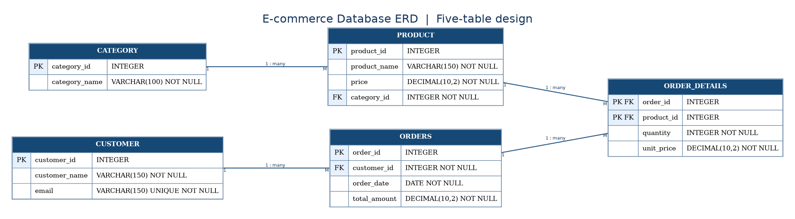

# E-commerce Database Design

Database analysis and relational database design for an E-commerce system, developed as part of Java Mentorship #10.

## 1. Introduction

This project focuses on designing a relational database to manage product categories, products, customers, orders, and order details.

The project demonstrates database normalization, primary and foreign keys, entity relationships, SQL reporting, and denormalization concepts.

## 2. Technologies

- PostgreSQL (target database)
- SQL
- Entity-Relationship Diagrams (ERD)
- Git and GitHub

## 3. Database Features

- Manage product categories and products.
- Store customer information.
- Record customer orders.
- Track products, quantities, and unit prices within each order.
- Maintain relationships using primary and foreign keys.
- Apply database constraints to improve data integrity.
- Generate sales and customer spending reports.

## 4. Database Design

The database consists of five tables:

| Table | Description |
|---|---|
| CATEGORY | Stores product categories. |
| PRODUCT | Stores products, prices, and category references. |
| CUSTOMER | Stores customer information. |
| ORDERS | Stores customer orders, dates, and total amounts. |
| ORDER_DETAILS | Stores products, quantities, and unit prices for each order. |

### Entity Relationships

- CATEGORY (1) → (M) PRODUCT
- CUSTOMER (1) → (M) ORDERS
- ORDERS (1) → (M) ORDER_DETAILS
- PRODUCT (1) → (M) ORDER_DETAILS

ORDER_DETAILS is an associative table that represents the many-to-many relationship between ORDERS and PRODUCT.

Its composite primary key consists of ORDER_ID and PRODUCT_ID.

### Entity-Relationship Diagram



## 5. SQL Reports

The project includes three reporting queries.

### Report 1 — Daily Revenue

Calculates total order amounts grouped by order date.

### Report 2 — Monthly Top-Selling Products

Identifies products with the highest total quantity ordered during October 2026.

### Report 3 — Customers Spending More Than $500

Identifies customers whose total order amounts exceed $500 during October 2026.

The queries demonstrate JOIN, WHERE, SUM, GROUP BY, HAVING, and ORDER BY.

## 6. Denormalization

Denormalization involves intentionally storing redundant or precomputed data to improve specific database operations.

For example, the CUSTOMER table could include a TOTAL_SPENDING column containing the sum of the customer's order amounts.

**Benefit:** Frequently requested spending totals may be retrieved without recalculating them from ORDERS.

**Risk:** The stored total may become inconsistent when orders are inserted, updated, or deleted.

**Possible solution:** Keep the stored total synchronized with order changes using a reliable update strategy, such as database transactions.

This is a proposed optimization, not an implemented feature in the current schema.

## 7. Project Structure

```text
ecommerce-database-design/
├── README.md
├── diagrams/
│   └── ecommerce_erd_final.png
└── sql/
    ├── 01_schema.sql
    ├── 02_sample_data.sql
    └── 03_reports.sql
```

## 8. Setup and Execution

1. Open a PostgreSQL-compatible SQL environment.
2. Execute `sql/01_schema.sql` to create the database tables.
3. Execute `sql/02_sample_data.sql` to insert fictional test records.
4. Execute `sql/03_reports.sql` to generate the three reports.

The SQL scripts were successfully tested using an online PostgreSQL Playground with the provided sample data.

## 9. Design Assumptions

- Each product belongs to one category.
- Each order belongs to one customer.
- An order can contain multiple products.
- Each product appears at most once per order, with its quantity recorded in ORDER_DETAILS.
- Order totals are stored in ORDERS and must remain consistent with order details.
- All recorded orders are included in the reporting calculations.
- The reporting period for the monthly examples is October 2026.
- Payment status, refunds, and cancelled orders are outside the current simplified schema.

These assumptions should be reviewed against the business requirements before production use.

## 10. Future Improvements

- Add order and payment status tracking.
- Support product inventory management.
- Handle cancellations and refunds.
- Add automated data consistency checks.
- Introduce indexes based on measured query performance.
- Evaluate denormalization when justified by performance testing.

## 11. Project Status

The database schema, sample data, SQL reports, and ERD have been completed as part of Java Mentorship #10.

### SQL Testing

The SQL scripts were executed successfully using an online PostgreSQL Playground.

- **Database Schema:** All five tables were created successfully.
- **Sample Data:** Test records were inserted successfully.
- **Daily Revenue:** Passed — returned the expected daily totals.
- **Monthly Top-Selling Products:** Passed — Keyboard (4), Laptop (3), Mouse (3).
- **Customers Spending Over $500:** Passed — Ahmed ($2,525).

All three reporting queries returned the expected results using the provided sample data.

**Testing scope:** Basic schema creation, sample data insertion, and report execution. Additional edge-case and constraint testing has not been performed.
